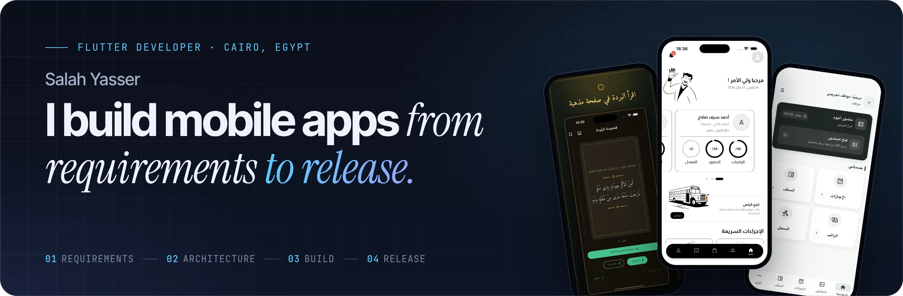
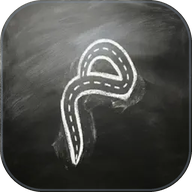

  
  
  
  

## Hi, I'm Salah 👋

**Flutter Developer in Cairo, Egypt.** I build mobile apps from requirements to release.

I work at **BDC Business Services**, and I also take on client work as a freelancer. I own the whole path: architecture, UI, APIs, iOS signing and App Store & Google Play releases.

## 📱 Apps on the stores

<table>
  <tr>
    <td width="33%" valign="top">
      
      <b>El Madrasah</b> 
      BUILT AT BDC
        
      
School app. I built the parent and driver roles end to end and the offline sync, improved performance, and handled both store releases.

      

        
        
      

      <a href="https://salahyasser.github.io/projects/el-madrasah/"><b>Read the case study →</b></a>
    </td>
    <td width="33%" valign="top">
      
      <b>Al-Burda</b> 
      CLIENT PROJECT
        
      
Built from scratch as a solo developer from the client's requirements. Arabic (RTL), reminders, iOS Lock-Screen widgets.

      

        
        
      

      <a href="https://salahyasser.github.io/projects/al-burda/"><b>Read the case study →</b></a>
    </td>
    <td width="33%" valign="top">
      
      <b>FLEXI</b> 
      CLIENT PROJECT
        
      
Built from scratch as a solo developer from the client's requirements. Employee app with attendance, QR check-in, leave requests and shifts.

      

        
      

      <a href="https://salahyasser.github.io/projects/flexi/"><b>Read the case study →</b></a>
    </td>
  </tr>
</table>

> [!NOTE]
> Most of my production work lives in private client and company repositories, so it doesn't show up on this profile. The case studies above walk through what I built; the public repos below are personal learning projects.

## 🧭 How I work

<table>
  <tr>
    <td width="25%" valign="top"><b>01</b> <b>Requirements</b> I start from your requirements, turn them into screens and user flows, and agree on scope before writing code.</td>
    <td width="25%" valign="top"><b>02</b> <b>Architecture</b> I set up a clean Flutter structure with Bloc for state management, so the app stays easy to extend as features grow.</td>
    <td width="25%" valign="top"><b>03</b> <b>Build</b> I build the UI, connect the APIs, and handle the hard parts like offline sync and performance.</td>
    <td width="25%" valign="top"><b>04</b> <b>Release</b> I handle iOS signing, TestFlight builds and App Store &amp; Google Play submissions, through to a live app.</td>
  </tr>
</table>

## 🛠️ Tech I use

**Bloc / Cubit** · **Clean Architecture** · **REST APIs** · **Hive / Drift** · **Stripe & PayPal** · **Google Maps** · **TestFlight**

---

  <b>Building a mobile product? Let's talk.</b> 
  <a href="mailto:salahy.allaithy@gmail.com">salahy.allaithy@gmail.com</a> · <a href="https://www.linkedin.com/in/SalahYasserAllaithy">LinkedIn</a> · <a href="https://salahyasser.github.io/">salahyasser.github.io</a>

