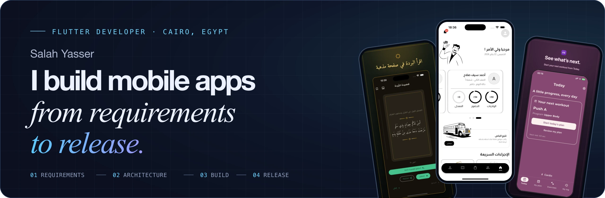
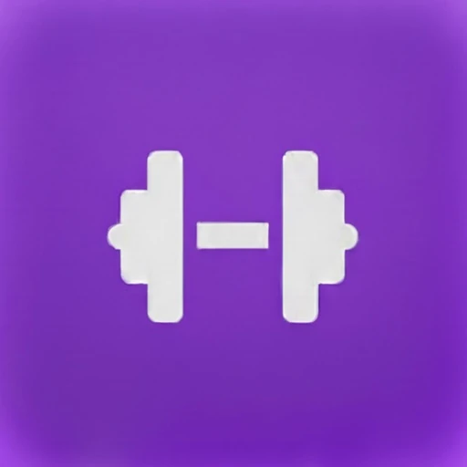
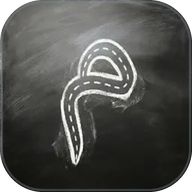
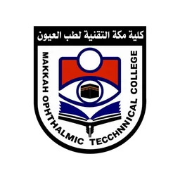

  
  
  
  

## Hi, I'm Salah 👋

**Flutter Developer in Cairo, Egypt.** I build mobile apps from requirements to release, with a focus on clean architecture, reliable offline flows, and iOS and Android delivery.

My work spans production apps built with **BDC Business Services**, solo client projects, and my own product, **Train&Sync**. Five projects featured below are live on at least one app store.

## 📱 Shipped apps

<table>
  <tr>
    <td valign="top">
      
      <b>Train&amp;Sync</b> 
      OWN PRODUCT · FLUTTER
        
      
I designed and shipped a bilingual workout planner for routines, strength and cardio logs, session history, and local backup export. Live on iOS; Android is in closed testing.

      

      <a href="https://salahyasser.github.io/projects/train-sync/"><b>Read the case study →</b></a>
    </td>
  </tr>
</table>

<table>
  <tr>
    <td width="50%" valign="top">
      
      <b>El Madrasah</b> 
      BUILT AT BDC · FLUTTER
        
      
A school platform for parents, students, teachers, and drivers. I built parent and driver flows and offline-first sync.

      

        
        
      

      <a href="https://salahyasser.github.io/projects/el-madrasah/"><b>Read the case study →</b></a>
    </td>
    <td width="50%" valign="top">
      
      <b>Al-Burda</b> 
      SOLO CLIENT PROJECT · FLUTTER
        
      
An offline Arabic reading and listening app I built from the client's requirements, with reminders and an iOS lock-screen widget.

      

        
        
      

      <a href="https://salahyasser.github.io/projects/al-burda/"><b>Read the case study →</b></a>
    </td>
  </tr>
  <tr>
    <td width="50%" valign="top">
      
      <b>FLEXI</b> 
      SOLO CLIENT PROJECT · FLUTTER
        
      
An employee and manager app I built for attendance, QR check-in, shifts, leave requests, and payroll access.

      

        
        
      

      <a href="https://salahyasser.github.io/projects/flexi/"><b>Read the case study →</b></a>
    </td>
    <td width="50%" valign="top">
      
      <b>Makkah College</b> 
      BUILT AT BDC · REACT NATIVE
        
      
A university app for students and staff, with role-based academic services and real-time communication. I worked on it as a developer on the BDC team.

      

        
        
      

      <a href="https://salahyasser.github.io/projects/makkah-college/"><b>Read the case study →</b></a>
    </td>
  </tr>
</table>

## 🧪 More work on TestFlight

<table>
  <tr>
    <td width="50%" valign="top"><b>PersonaRise</b> BDC TEAM · FLUTTER
An AI personal-branding platform for analysing a professional profile and preparing content for LinkedIn and X.
On TestFlight</td>
    <td width="50%" valign="top"><b>RFMS</b> TEAM PROJECT · FLUTTER
A mobile workspace for rabbit-farm operations, including cages, breeding, health cases, and daily tasks.
On TestFlight</td>
  </tr>
</table>

## 🧩 Open source

<table>
  <tr>
    <td valign="top">
      <b><a href="https://github.com/SalahYasser/flutter_lock_screen_widget">flutter_lock_screen_widget</a></b> 
      PUBLIC SAMPLE
        
      
A public sample of the same lock-screen widget pattern I used in Al-Burda, written from scratch.

      

      WidgetKit + App Intents · home_widget · App Group · Cubit · 57 tests
        
      <a href="https://github.com/SalahYasser/flutter_lock_screen_widget"><b>View the code →</b></a>
    </td>
  </tr>
</table>

> [!NOTE]
> Most production code lives in private client and company repositories. The public case studies explain my contribution, and the open-source widget sample shows a focused piece of my Flutter work.

## 🧭 How I work

<table>
  <tr>
    <td width="25%" valign="top"><b>01</b> <b>Requirements</b> I start from your requirements, turn them into screens and user flows, and agree on scope before writing code.</td>
    <td width="25%" valign="top"><b>02</b> <b>Architecture</b> I set up a clean Flutter structure with Bloc for state management, so the app stays easy to extend as features grow.</td>
    <td width="25%" valign="top"><b>03</b> <b>Build</b> I build the UI, connect the APIs, and handle the hard parts like offline sync and performance.</td>
    <td width="25%" valign="top"><b>04</b> <b>Release</b> I handle iOS signing, TestFlight builds and App Store &amp; Google Play submissions, through to a live app.</td>
  </tr>
</table>

## 🛠️ Tech I use

**Flutter / Dart** · **React Native / TypeScript** · **Bloc / Cubit** · **Clean Architecture** · **PowerSync** · **REST APIs** · **Hive / Drift** · **WidgetKit** · **TestFlight**

---

  <b>Building a mobile product? Let's talk.</b> 
  <a href="mailto:salahy.allaithy@gmail.com">salahy.allaithy@gmail.com</a> · <a href="https://www.linkedin.com/in/SalahYasserAllaithy">LinkedIn</a> · <a href="https://salahyasser.github.io/">salahyasser.github.io</a>

<!-- Content reviewed 21 Nov 2026 against SalahYasser.github.io/src/data/projects.ts and its live case studies. Public store links verify release availability; Android closed testing and TestFlight statuses were supplied by Salah. The banner retains the existing portfolio visual identity. -->
